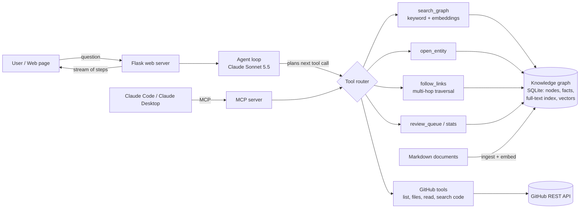

# Nexus: An Agentic Knowledge-Graph Assistant for Engineering Teams

**FA Activity: Agentic AI Application Implementation**

| | |
|---|---|
| **Students** | Mehul Rawat, Payal Lokhande |
| **Guide** | Santwana Gudhadhe |
| **Domain** | Document Intelligence Agent / Software Development Assistant |
| **Technology** | Python, Claude Sonnet 5.5 (Anthropic API, tool use), RAG (SQLite full-text search + local embeddings), Knowledge Graph, GitHub REST API, Model Context Protocol (MCP), Flask |
| **Source code** | https://github.com/VoyagerToko/agentic-ai-fa |

---

## A. Title
**Nexus: an agentic AI assistant that plans, retrieves and reasons over a company knowledge graph and live code repositories to answer engineering questions with sourced, verifiable answers.**

## B. Architecture Diagram

**Flow:** documents are ingested into a knowledge graph (entities + sourced facts) and embedded for semantic search. A question goes to the agent, which repeatedly *plans → calls a tool → reads the result* until it can answer. Every step is streamed live to the page, and every entity the agent touches is highlighted on the graph. The same tools are also exposed over MCP so external AI clients can use them.

---

## C. Working Application
Run `python app.py` and open `http://localhost:8030`. Three tabs:
- **Agent**: ask a question; watch each reasoning step and tool call appear live, with the entities used lit up on the graph; read a sourced answer.
- **Graph**: explore the knowledge graph, search by keyword or meaning, open an entity, and approve/reject unverified facts.
- **MCP**: connect Claude Code / Claude Desktop to the same tools.

## D. Source Code
GitHub: https://github.com/VoyagerToko/agentic-ai-fa

---

## E. Test Report

| # | Test case | Input | Expected result | Actual result | Status |
|---|---|---|---|---|---|
| 1 | Multi-step reasoning over the graph | "What breaks if Postgres goes down?" | Agent searches, opens each dependent service, traces indirect impact, answers with sources | Agent made 12 tool calls over 5 rounds, touched 18 entities, returned direct + indirect impact table and flagged an unverified (proposed) dependency | Pass |
| 2 | Tool/API integration (live code) | "In my VoyagerToko/pinn repo, what does the code do and which libraries does it use?" | Agent chooses GitHub tools instead of the graph and reads real files | Agent called repo file listing, read `README.md` and `requirements.txt`, and summarised the project and libraries correctly | Pass |
| 3 | RAG: retrieval by meaning | Search "keeping secrets safe" | Secrets Standard found even without exact words | Top result: Secrets Standard (matched by keyword + meaning), then Redis and Ava Patel by meaning | Pass |
| 4 | Human-in-the-loop verification | Approve the proposed fact "Mobile App must satisfy Testing Standard" | Fact becomes verified, counts update | Verified facts 73 → 74, proposed 2 → 1 | Pass |
| 5 | MCP interoperability | MCP `initialize` + `tools/list` from a client | Server responds with its tools | Server "nexus" replied on protocol 2025-06-18 with 11 tools; `tools/call follow_links(web-app)` returned the dependency chain | Pass |
| 6 | Safety: missing credentials | Ask a question with no API key / call a GitHub tool with no token | Clear error, no crash | "ANTHROPIC_API_KEY is not set" / "GitHub is not configured" returned as messages | Pass |
| 7 | Safety: read-only agent | Ask the agent to add or approve a fact | Agent cannot change the graph | Write tools are not given to the agent; only humans (UI) or MCP clients can propose/verify | Pass |

---

## F. Short Report

### 1. Introduction
Engineering knowledge is scattered across documents, people and code repositories. Answering simple questions such as "who owns this service?" or "what fails if the database goes down?" requires reading several documents and following chains of dependencies. Nexus is an agentic AI application that does this work autonomously: it plans which information it needs, retrieves it with tools, follows relationships across multiple hops, and returns an answer that cites its sources.

### 2. Problem Statement
A plain chatbot cannot answer these questions reliably because the answer is not in a single document and the model would guess. The task needs **planning** (deciding what to look up next), **retrieval** (finding the right documents), **multi-step tool use** (opening entities, tracing dependencies, reading live code) and **trustworthiness** (knowing which facts are verified).

### 3. Objectives
1. Convert organisational documents into a knowledge graph of entities and **sourced, status-tagged facts** (verified / proposed).
2. Build a **RAG layer** that combines keyword search and semantic (embedding) search.
3. Build an **autonomous agent** that plans and calls tools in a loop until it can answer.
4. Integrate an external **API** (GitHub) for live source-code questions.
5. Expose the tools through the **Model Context Protocol** so other AI clients can reuse them.
6. Make every step of the agent **visible** to the user, and keep the agent **read-only** for safety.

### 4. Proposed Agent Architecture
- **Knowledge layer:** SQLite stores `node` (entity), `fact` (subject–predicate–object with status and source), a full-text index and embedding vectors.
- **Retrieval layer:** hybrid search, keyword (SQLite FTS5, BM25 ranking) + meaning (local `bge-small-en-v1.5` embeddings), merged with reciprocal rank fusion.
- **Tool layer:** 9 read tools (graph search, open entity, follow links, stats, review queue, 4 GitHub tools) and 2 write tools (propose / verify fact) for MCP clients only.
- **Reasoning layer:** a single agent built on Claude Sonnet 5.5 with tool use, adaptive thinking and a 25-step safety limit.
- **Interface layer:** Flask web server streaming each step (Server-Sent Events) to a web page with a live graph; an MCP server for external clients.

### 5. Prompt Design
- **Role prompt:** the system prompt defines the assistant's role, the meaning of every relationship type (ownedBy, dependsOn, memberOf, …) and the difference between verified and proposed facts.
- **Tool-selection policy:** the prompt tells the agent *when* to use which tool (search first, open the entity before claiming something is missing, use GitHub only for live code).
- **Grounding rules:** "never invent facts", "say when a fact is only proposed", "name the entities you used".
- **Tool descriptions as prompts:** each tool's docstring is sent to the model as its description, so the model learns each tool's purpose and arguments.
- **Adaptive thinking with summaries:** the model decides how much to reason; its reasoning summaries are shown to the user for transparency.

### 6. RAG Implementation
1. **Ingestion:** each markdown document becomes a node; its front matter becomes facts (e.g. `dependsOn: postgres, redis`), each tagged with its source document. A `?` prefix marks a fact as proposed.
2. **Indexing:** text goes into a full-text index; each node is embedded into a 384-dimension vector using a local model (no external service).
3. **Retrieval:** a query is searched by keyword and by vector similarity; results are fused and each hit reports how it matched (keyword, meaning or both).
4. **Graph-augmented retrieval:** beyond similarity search, the agent follows typed relationships across multiple hops (`follow_links`), which plain vector RAG cannot do.
5. **Generation:** retrieved facts and documents are passed back to the model as tool results, and the answer cites them.

### 7. Tool / API Integration
| Tool | Purpose |
|---|---|
| `search_graph` | hybrid keyword + semantic search |
| `open_entity` | full entity: description, facts with status and source, document |
| `follow_links` | multi-hop traversal (dependencies, ownership) |
| `graph_stats`, `review_queue` | graph size, unverified facts |
| `list_repos`, `repo_files`, `read_file`, `search_code` | **GitHub REST API** (read-only personal access token) |
| `propose_fact`, `verify_fact` | write tools, offered only over MCP |

The **Anthropic Messages API** provides the reasoning model; the **Model Context Protocol** server exposes the same tools to Claude Code and Claude Desktop (stdio or HTTP).

### 8. Agent Workflow
1. User asks a question (with up to 6 previous turns as context).
2. The agent sends the question and tool list to Claude.
3. Claude plans and either answers or requests one or more tools.
4. The application runs the tools, records which entities were used, and streams each step to the page.
5. Results are returned to Claude; steps 3–5 repeat (up to 25 rounds).
6. Claude produces the final answer in Markdown, citing entities and flagging unverified facts.

### 9. Safety Mechanism
- **Read-only agent:** the agent has no tool that can modify data; changes require a human (UI approval) or an explicit MCP client.
- **Human-in-the-loop verification:** new or uncertain facts are stored as *proposed* and must be approved before they count as verified.
- **Provenance:** every fact keeps its source document; answers distinguish verified from proposed facts.
- **Model safety:** refusals from the model's safety classifiers are handled; server-side fallback retries declined requests safely.
- **Bounded autonomy:** a maximum of 25 reasoning rounds; tool results are truncated to safe sizes.
- **Secrets and privacy:** API keys live only in a local `.env` file (never committed); the GitHub token is read-only; the server listens on localhost only; demo data is fictional.

### 10. Results
The agent answered multi-hop questions correctly by combining several tools in sequence (for example 12 tool calls across 18 entities for the Postgres impact question), chose GitHub tools automatically for code questions, and found entities by meaning as well as by keyword. All 7 test cases passed. The live step view makes the agent's planning and tool use observable during the demonstration.

### 11. Limitations
- The demo knowledge base is small and fictional (27 documents).
- Facts are extracted from structured front matter; free-text relationships are not yet extracted automatically.
- Chat history is kept in memory and lost on restart.
- Requires an Anthropic API key and internet access for the model.

### 12. Future Scope
- Automatic fact extraction from unstructured documents with the LLM, proposed for human review.
- Connectors for Google Drive, Confluence and ticketing systems.
- A multi-agent version (planner, researcher, verifier agents).
- User authentication and role-based access to sensitive facts.
- Evaluation dashboard measuring answer accuracy and citation quality.
